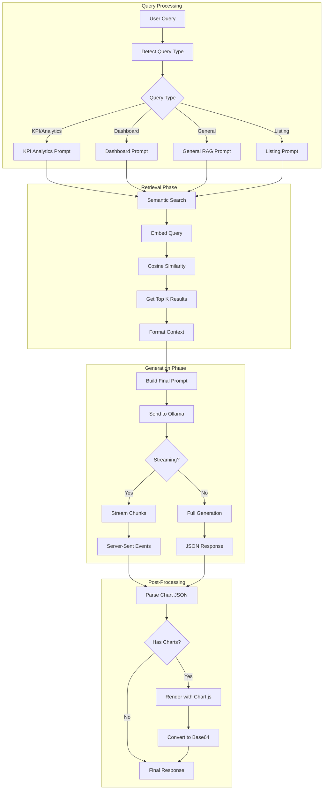
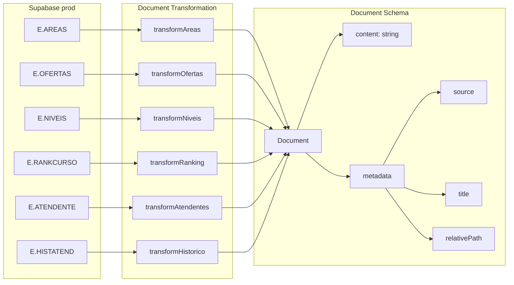
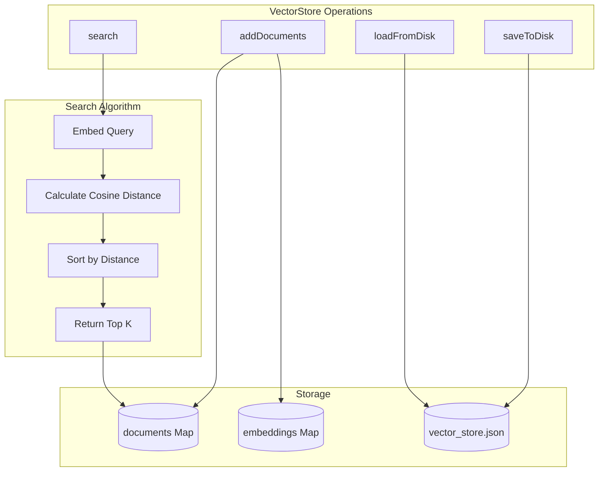
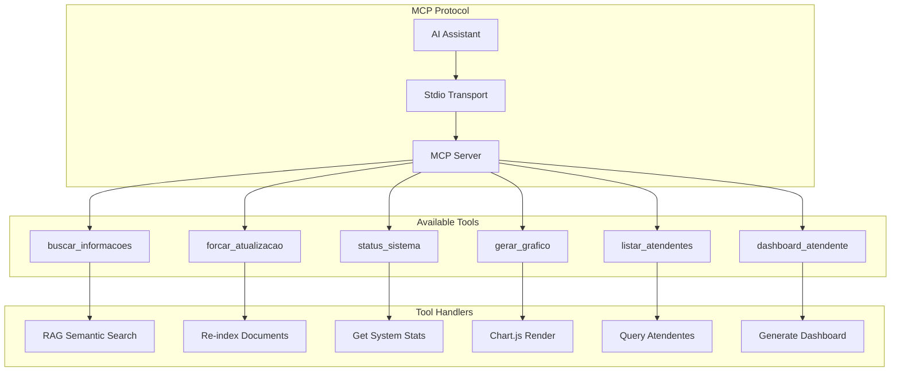
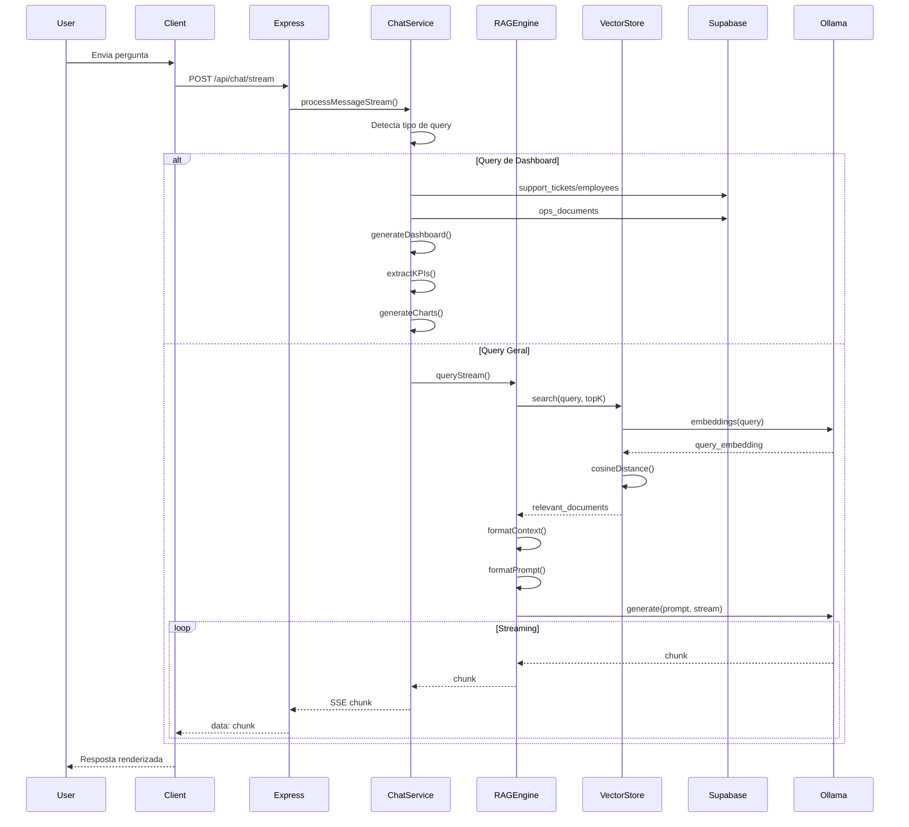
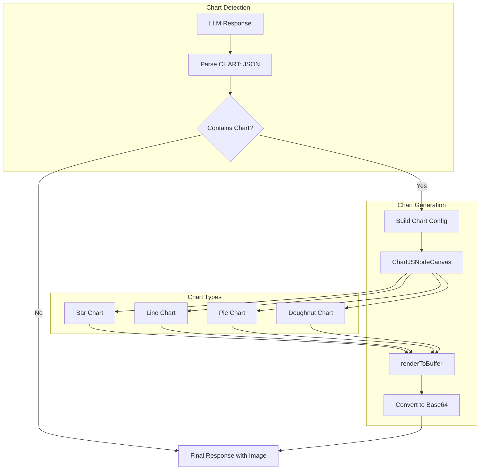

# RAG System Architecture - Supabase (ops_documents)

Este documento descreve a arquitetura completa do sistema RAG (Retrieval Augmented Generation) implementado no projeto.

## Visão Geral

O sistema combina **busca semântica vetorial** com **consultas à base Supabase (ops_documents)**, usando **Ollama** como LLM local para geração de respostas contextualizadas.

---

## Diagrama Principal do Fluxo RAG

```mermaid
flowchart TD
    subgraph Cliente
        A[React Client]
        A1[Chat Interface]
        A2[Dashboard View]
    end

    subgraph "Express Server"
        B[Express App]
        B1[/api/chat - Chat Routes/]
        B2[/api (Next routes)/]
        B3[/api/admin - Admin Routes/]
    end

    subgraph "Chat Service"
        C[ChatService]
        C1{Tipo de Query?}
        C2[Dashboard Generator]
        C3[Matrículas Processor]
        C4[General RAG Query]
    end

    subgraph "RAG Engine Layer"
        D[DocumentRAGEngine]
        D1[Query Type Detection]
        D2[Context Formatter]
        D3[Prompt Templates]
    end

    subgraph "Retrieval Layer"
        E[SupabaseDocumentLoader]
        F[VectorStore]
        G[Supabase (ops_documents)]
    end

    subgraph "Embedding & Storage"
        H[OllamaEmbedding]
        I[(chroma_db/vector_store.json)]
        J[(DataCache)]
    end

    subgraph "LLM Generation"
        K[Ollama Server]
        K1[gemma3:1b - LLM Model]
        K2[nomic-embed-text - Embedding Model]
    end

    subgraph "Output Processing"
        L[Streaming Response]
        M[KPI Processor]
        N[Chart Generator]
    end

    subgraph "MCP Integration"
        O[MCP Server]
        O1[buscar_informacoes Tool]
        O2[gerar_grafico Tool]
        O3[forcar_atualizacao Tool]
    end

    A --> B
    A1 --> B1
    A2 --> B1
    B1 --> C
    B2 --> G

    C --> C1
    C1 -->|Dashboard Query| C2
    C1 -->|Matrículas Query| C3
    C1 -->|General Query| C4

    C2 --> M
    C3 --> D
    C4 --> D

    D --> D1
    D1 --> D3
    D --> D2

    D --> E
    D --> F
    D --> G

    E -->|Load Documents| G
    E -->|Transform to Documents| F

    F --> H
    H --> K2
    F --> I
    G --> J

    D2 --> K1
    K1 --> L

    M --> N
    N --> L

    L --> A

    O --> D
    O1 --> F
    O2 --> N
    O3 --> E
```

---

## Fluxo de Inicialização e Indexação

```mermaid
flowchart TD
    subgraph "Startup Process"
        START[Server Start] --> INIT[ChatService.initialize]
        INIT --> CHECK_CACHE{Cache Exists?}
        
        CHECK_CACHE -->|Yes| LOAD_CACHE[Load from chroma_db]
        CHECK_CACHE -->|No| CHECK_MODELS[Check Ollama Models]
        
        LOAD_CACHE --> CACHE_VALID{Cache Valid?}
        CACHE_VALID -->|Yes| SET_EMBED[Set Embedding Function]
        CACHE_VALID -->|No| CHECK_MODELS
        
        CHECK_MODELS --> HAS_LLM{Has gemma3:1b?}
        HAS_LLM -->|No| PULL_LLM[Pull LLM Model]
        HAS_LLM -->|Yes| HAS_EMBED{Has nomic-embed-text?}
        PULL_LLM --> HAS_EMBED
        
        HAS_EMBED -->|No| PULL_EMBED[Pull Embedding Model]
        HAS_EMBED -->|Yes| SET_EMBED
        PULL_EMBED --> SET_EMBED
        
        SET_EMBED --> READY[System Ready]
    end

    subgraph "Indexation Process"
        INDEX_START[Index Documents] --> LOAD_DB[Load from ops_documents]
        
        LOAD_DB --> TRANSFORM[Transform to Documents]
        
        TRANSFORM --> GEN_EMBED[Generate Embeddings]
        GEN_EMBED --> BATCH[Process in Batches of 10]
        BATCH --> STORE[Store in VectorStore]
        STORE --> PERSIST[Save to chroma_db]
        PERSIST --> HASH[Save Content Hash]
    end
```



---

## Fluxo de Query RAG



---

## Componentes Detalhados

### 1. Document Loader (SupabaseDocumentLoader)



### 2. Vector Store



### 3. Prompt System

```mermaid
flowchart TD
    subgraph "Query Type Detection"
        Q[Query Input]
        Q --> REGEX{Regex Patterns}
        
        REGEX -->|kpi|analytics|métricas| KPI[KPI_ANALYTICS]
        REGEX -->|dashboard|painel| DASH[DASHBOARD]
        REGEX -->|quem são|liste|todos| LIST[LISTING]
        REGEX -->|default| GEN[GENERAL]
    end

    subgraph "Prompt Templates"
        KPI --> KPI_TPL["KPI_ANALYTICS_PROMPT_TEMPLATE
        - Calcular métricas
        - Identificar padrões
        - Gerar insights"]
        
        DASH --> DASH_TPL["DASHBOARD_PROMPT_TEMPLATE
        - Estrutura para dashboards
        - Métricas principais
        - Dados para gráficos"]
        
        LIST --> LIST_TPL["LISTING_PROMPT_TEMPLATE
        - Apresentar TODOS os itens
        - Formato de lista
        - Dados completos"]
        
        GEN --> GEN_TPL["RAG_PROMPT_TEMPLATE
        - Resposta estruturada
        - Usar contexto
        - Gerar gráficos quando apropriado"]
    end
```

### 4. MCP Server Tools



---

## Fluxo de Dados Completo



---

## Configurações do Sistema

| Variável | Padrão | Descrição |
|----------|--------|-----------|
| `LLM_MODEL` | `gemma3:1b` | Modelo de geração de texto |
| `EMBEDDING_MODEL` | `nomic-embed-text` | Modelo de embeddings |
| `OLLAMA_HOST` | `http://localhost:11434` | URL do servidor Ollama |
| `TOP_K_RESULTS` | `5` | Documentos retornados na busca |
| `CHROMA_PERSIST_DIR` | `./chroma_db` | Diretório de persistência |
| `CACHE_MAX_AGE_HOURS` | `1` | TTL do cache em horas |

---

## Estrutura de Arquivos RAG

```
server/features/
├── rag/
│   ├── engine.ts           # RAGEngine básico (API-based)
│   ├── document-engine.ts  # DocumentRAGEngine (Vector-based)
│   ├── prompt.ts           # Templates de prompts
│   ├── kpi-processor.ts    # Extração de KPIs
│   └── types.ts            # Tipos TypeScript
├── documents/
│   ├── vector-store.ts     # VectorStore com embeddings
│   ├── supabase-loader.ts  # Loader de documentos Supabase (ops_documents)
│   ├── persistence.ts      # Persistência em disco
│   └── types.ts            # Tipos de documentos
├── chat/
│   ├── service.ts          # ChatService principal
│   ├── routes.ts           # Rotas HTTP
│   └── types.ts            # Tipos de chat
├── api-client/
│   ├── client.ts           # APIClient genérico + Supabase
│   └── types.ts            # Tipos de API
└── mcp/
    ├── server.ts           # Servidor MCP
    └── chart-utils.ts      # Utilitários de gráficos
```

---

## Fluxo de Geração de Gráficos

